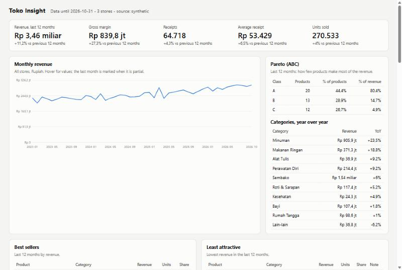
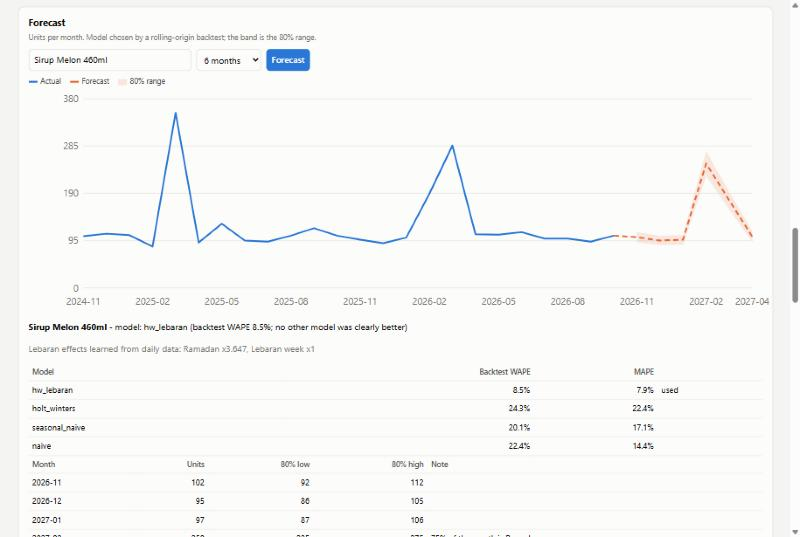
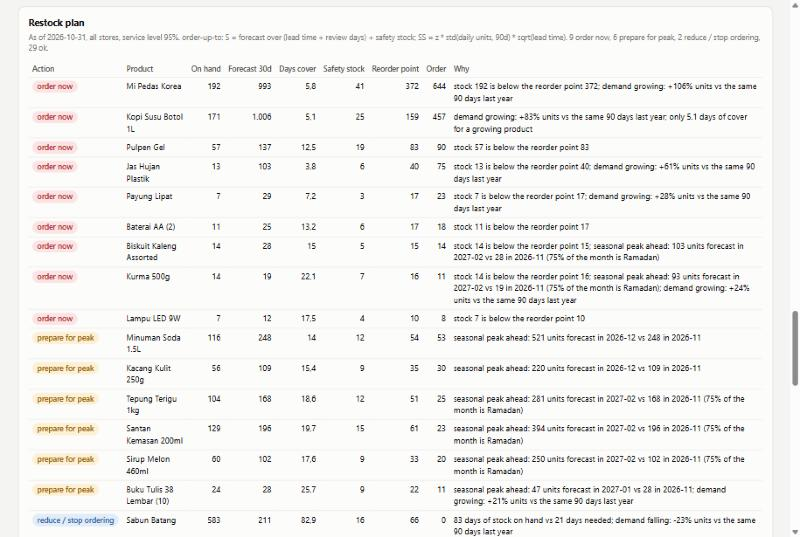
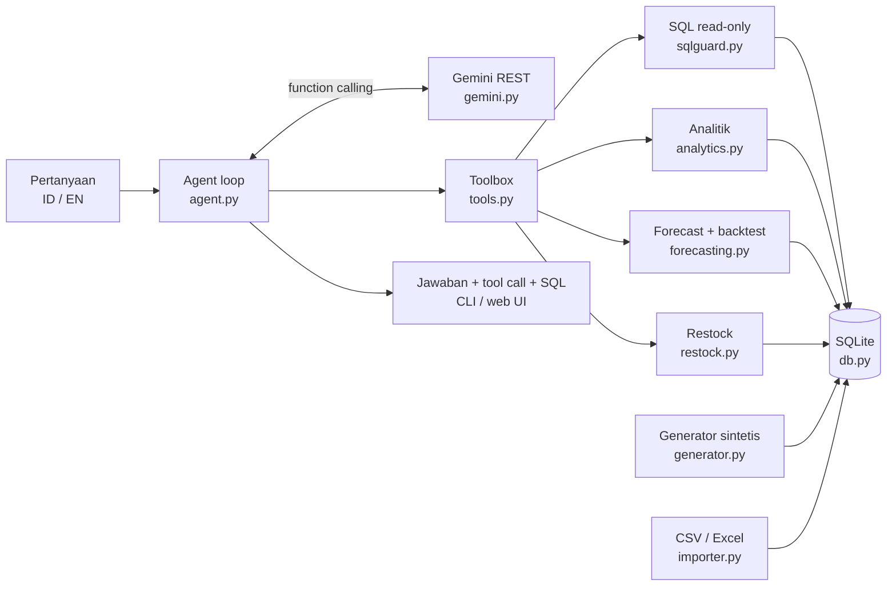

# Toko Insight

Agen AI untuk analitik penjualan minimarket. Anda bisa bertanya dalam Bahasa Indonesia atau
English, misalnya *"Produk apa yang musiman saat Ramadan?"*, *"Kalau beli roti tawar, biasanya
beli apa lagi?"*, atau *"Barang apa yang perlu ditambah stoknya bulan depan, dan kenapa?"*.

Agen ini (Gemini dengan function calling) menjawab dengan memanggil **tool yang aman**: SQL
read-only dan fungsi analitik. Semua angka berasal dari tool, bukan karangan model. Setiap
jawaban juga menampilkan daftar tool call beserta SQL yang dijalankan.

> English: [README.md](README.md)



| Forecast dengan penyesuaian Lebaran | Rencana restock beserta alasannya |
|---|---|
|  |  |

Kenapa proyek ini terpisah dari aplikasi RAG: RAG mencari teks. Pertanyaan seperti "produk apa
yang tumbuh paling cepat", "apa yang sering dibeli bersamaan", atau "berapa Sirup yang akan
terjual bulan Februari" butuh **perhitungan atas tabel**: agregasi, statistik, dan forecasting.
Proyek ini mengerjakannya dengan tool calling, text-to-SQL, dan model time-series sungguhan yang
diuji dengan backtest.

Proyek ini terinspirasi dari magang saya, saat saya membangun AWS Bedrock Agent di atas data
penjualan toko. Versi ini cukup berjalan di laptop dengan Python standard library dan numpy.

## Pertanyaan yang bisa dijawab

| Jenis pertanyaan | Tool | Metode |
|---|---|---|
| Tren dari waktu ke waktu | `sales_trend` | deret harian/mingguan/bulanan/tahunan, puncak, titik terendah, tren linear |
| Produk terlaris / paling kurang diminati | `top_products`, `abc_analysis` | ranking, kelas Pareto (ABC) |
| Produk tumbuh dan menurun | `growth` | year over year, menandai produk baru dan yang sudah tidak dijual |
| Sering vs jarang dibeli | `purchase_frequency` | persentase struk yang berisi produk itu |
| Dibeli bersamaan | `basket_pairs` | market basket analysis: support, confidence, lift |
| Produk musiman | `seasonality` | indeks event untuk Ramadan (tanggal Lebaran yang bergeser), musim sekolah, akhir tahun, musim hujan dan kemarau |
| Forecast | `forecast` | Holt-Winters dengan penyesuaian Lebaran, diuji backtest melawan seasonal-naive |
| Stok ditambah atau dikurangi | `restock_plan` | forecast + safety stock + reorder point vs stok di tangan, beserta alasannya |
| Pertanyaan lain | `run_sql` | satu `SELECT` read-only yang divalidasi, dengan batas baris dan waktu |

## Mulai cepat

```powershell
py -m pip install -r requirements.txt -r requirements-dev.txt   # numpy + pytest
py -m tokoinsight generate          # data sintetis: 3 toko, 46 produk, Jan 2023 - Okt 2026 (~6 detik)
py -m tokoinsight report restock    # jalan offline, tanpa API key
py -m tokoinsight serve             # dashboard di http://127.0.0.1:8000
py -m pytest                        # 79 test, LLM palsu, tanpa key
```

Untuk chat, salin `.env.example` menjadi `.env` lalu isi `GEMINI_API_KEY` (key gratis dari
<https://aistudio.google.com/apikey>). `TOKO_MODEL` memilih model (default `gemini-3.8-flash`);
`gemini-3.5-flash-lite` paling cepat dan dipakai untuk eval:

```powershell
py -m tokoinsight ask "Produk apa saja yang musiman saat Ramadan dan menjelang Lebaran?"
py -m tokoinsight chat
```

`ask` mencetak jawaban, lalu setiap tool call beserta argumen dan SQL yang dijalankan.

### Laporan offline (tanpa API key)

```powershell
py -m tokoinsight report overview
py -m tokoinsight report top -n 10            # atau: bottom, abc, growth, frequency, pairs
py -m tokoinsight report seasonality
py -m tokoinsight report forecast --product "Sirup Melon" --horizon 6
py -m tokoinsight report restock --only-actions
py -m tokoinsight sql "SELECT substr(date,1,4) y, AVG(payment_method='qris') FROM transactions GROUP BY 1"
```

### Data toko sendiri

```powershell
py -m tokoinsight --db data/mytoko.db import penjualan.csv
py -m tokoinsight --db data/mytoko.db serve
```

Format yang diharapkan: satu baris per item di struk (atau per produk per hari). Nama kolom
dikenali dalam Bahasa Indonesia atau Inggris, misalnya `tanggal/date`, `produk/product`,
`jumlah/qty`, `harga/price`, `total/revenue`, `cabang/store`, `no_nota/receipt`, dan `hpp/cost`.
Format `Rp 12.500`, `12.500,00`, dan `31/03/2025` juga dipahami. File Excel butuh `openpyxl`,
atau simpan saja sebagai CSV.

Hasil import juga melaporkan data yang kurang. Tanpa kolom nomor nota, analisis keranjang belanja
tidak bisa dilakukan. Tanpa data stok, rencana restock hanya menampilkan forecast.

## Arsitektur



Agent loop mengirim pertanyaan dan deklarasi tool ke Gemini. Gemini lalu menjawab atau meminta
function call. Toolbox menjalankan call tersebut dan mengirim hasilnya kembali, dan loop ini
berulang hingga maksimal 8 langkah. Setelah itu model dipaksa menjawab (`toolConfig.mode = NONE`).

Error dari tool, misalnya query ditolak atau produk tidak ditemukan, dikirim balik ke model
sebagai data. Dengan begitu model bisa memperbaiki langkahnya sendiri.

## Forecasting: kenapa "hw_lebaran"

Lebaran mengikuti kalender Hijriah dan maju sekitar 11 hari setiap tahun (31 Mar 2025,
20 Mar 2026, 10 Mar 2027). Model "bulan yang sama tahun lalu" jadi menaruh puncak Ramadan di
bulan yang salah. Holt-Winters biasa dengan musim 12 bulan juga mengalami masalah yang sama.

`hw_lebaran` mengatasinya dalam empat langkah:

1. Dari data harian, model mengestimasi efek Ramadan dan efek minggu Lebaran untuk tiap produk:
   jumlah unit di dalam window dibagi unit yang diharapkan dari 45 hari di sekitarnya, digabung
   dari semua tahun. Efek hanya dipakai kalau jelas lebih besar dari noise (|z| > 3), supaya
   produk yang jarang laku tidak mendapat puncak palsu.
2. Setiap bulan historis dibagi dengan faktor hari raya-nya:
   `1 + (efek - 1) × porsi hari bulan itu yang masuk window`.
3. Holt-Winters (damped trend, musim multiplikatif, parameter dari grid search) di-fit pada deret
   yang sudah disesuaikan.
4. Hasil forecast dikalikan dengan faktor hari raya untuk bulan-bulan **mendatang**, memakai
   tanggal Lebaran yang sebenarnya.

Setiap forecast juga menjalankan **rolling-origin backtest**: 4 titik awal × 3 bulan selama
12 bulan terakhir, dengan fit ulang di setiap titik awal. Hasilnya dibandingkan dengan
`seasonal_naive`, `holt_winters` biasa, dan `naive`, lalu dilaporkan MAPE dan WAPE-nya.

`hw_lebaran` tetap dipakai kecuali ada model lain yang jelas lebih baik (WAPE di bawah 85% dari
WAPE `hw_lebaran`). Rentang 80% dihitung dari error backtest.

## Evaluasi

Generator data sintetis sengaja menanam semua efek yang harus ditemukan, lalu menyimpan ground
truth-nya. Efek yang ditanam antara lain puncak Ramadan di tanggal yang benar, produk yang tumbuh,
produk yang menurun, produk yang berhenti dijual, produk baru, pasangan produk, produk yang jarang
dibeli, serta stok yang berlebih dan yang kurang. Jadi jawaban yang diharapkan diketahui pasti,
bukan dinilai oleh LLM lain.

Hasil offline pada dataset default ([evals/reports/offline.md](evals/reports/offline.md)):

- **Analitik: 34/34 cek lolos.** Cek ini mencakup:
  - produk teratas menurut omzet dan unit
  - produk dengan pertumbuhan tercepat, produk yang menurun, produk yang berhenti dijual, dan
    produk baru
  - ke-14 produk yang sangat musiman, masing-masing dengan musim yang benar
  - ke-5 pasangan produk yang ditanam, yang muncul sebagai 5 teratas menurut lift
  - produk yang jarang dibeli
  - keputusan tambah/kurangi stok
  - forecast yang memuncak di bulan Ramadan
  - porsi pembayaran QRIS yang naik setiap tahun
- **Backtest forecast, WAPE selama 12 bulan terakhir:**

| deret | hw_lebaran | holt_winters | seasonal_naive | naive |
|---|---|---|---|---|
| semua produk (jumlah error per produk) | **5,5%** | 6,0% | 7,6% | 11,8% |
| produk Ramadan | **8,9%** | 18,3% | 17,0% | 19,6% |
| total toko | **2,2%** | 2,6% | 4,0% | 7,8% |

Untuk produk Ramadan, penyesuaian Lebaran memangkas error sampai separuhnya. `hw_lebaran` lebih
akurat daripada seasonal-naive pada 28 dari 44 produk. Untuk produk datar yang tidak musiman,
hasil semua model mirip.

**Agen, langsung ke Gemini** (`gemini-3.5-flash-lite`, free tier):

- **Suite tulisan tangan: 13/14.** 14 pertanyaan di [evals/questions.json](evals/questions.json)
  (Bahasa Indonesia dan Inggris), masing-masing dengan isi jawaban yang diharapkan (misalnya
  "Kurma", "Sirup", dan "Biskuit Kaleng" untuk Ramadan) dan tool yang diharapkan. Pilihan tool
  benar di 14 pertanyaan. Satu yang gagal kehabisan langkah tanpa teks; sekarang agen meminta
  jawaban sekali lagi tanpa tool.
- **Suite generatif: 273 dari 279 benar (97,8%).** [evalgen.py](tokoinsight/evalgen.py) membuat
  500 pertanyaan dari 15 template, dengan jawaban pasti yang dihitung lewat SQL (unit, omzet,
  struk, rata-rata belanja, porsi QRIS, produk teratas per kategori, pasangan, musim puncak,
  pertumbuhan, forecast, jam tersibuk, hari Lebaran, promo). Free tier hanya mengizinkan 500
  request per hari, jadi run berhenti di 279 dan bisa dilanjutkan dari titik itu. Bahasa
  Indonesia 98,6%, Inggris 97,1%. 97,1% jawaban *grounded*: angka yang diharapkan ada di hasil
  tool, bukan hanya di teks. 12 dari 15 template 100%. Rata-rata 2,3 panggilan tool dan 28 detik
  per pertanyaan.

| template | benar | yang salah |
|---|---|---|
| porsi QRIS per cabang dan tahun | 9/13 | menebak nilai `payment_method` di SQL |
| jumlah struk di hari pertama Lebaran | 6/7 | menghitung tanggal lain (144, seharusnya 58) |
| omzet cabang dalam sebulan | 24/25 | menjawab Rp 3,8 miliar, seharusnya Rp 94 juta |
| 12 template lainnya | 245/245 | |

Setelah run ini saya menambahkan nilai `payment_method` ke skema yang dilihat model. Perbaikan
itu belum diukur ulang.

```powershell
py -m tokoinsight eval --suite analytics
py -m tokoinsight eval --suite forecast
py -m tokoinsight eval --suite agent      # butuh GEMINI_API_KEY; 14 pertanyaan, diberi jeda untuk free tier
py -m tokoinsight eval --suite agent500   # 500 pertanyaan generatif; bisa dilanjutkan, berhenti rapi saat kuota harian habis
```

## Keamanan

Model hanya bisa memanggil tool yang dideklarasikan, dan argumen disaring sesuai nama, tipe, dan
enum yang dideklarasikan. `run_sql` punya tiga lapis pengaman:

1. Validator: hanya satu statement, hanya `SELECT`/`WITH`, dan tanpa keyword tulis/DDL/`PRAGMA`/
   `ATTACH` atau fungsi berbahaya di luar string literal.
2. Koneksi read-only: `mode=ro` ditambah `PRAGMA query_only`.
3. **Authorizer** SQLite yang hanya mengizinkan operasi baca, ditambah timeout 5 detik dan batas
   200 baris.

Test membuktikan bahwa operasi tulis tetap gagal walaupun validatornya dilewati.

## Tur kode

| File | Isi |
|---|---|
| `tokoinsight/calendar_id.py` | Tanggal Lebaran 2021-2028, window Ramadan / sekolah / akhir tahun, event mendatang |
| `tokoinsight/generator.py` | Minimarket sintetis: spesifikasi produk (permintaan dasar, tren, musim), pasangan produk, promo, inflasi, adopsi QRIS, stok, ground truth |
| `tokoinsight/db.py` | Skema SQLite, view `sales`, agregat `daily_sales`, tabel kalender, log query untuk menampilkan SQL |
| `tokoinsight/importer.py` | Import CSV/Excel dengan alias kolom Indonesia/Inggris serta format angka dan tanggal; ekspor CSV |
| `tokoinsight/analytics.py` | Tren, terlaris/terbawah, ABC, pertumbuhan, frekuensi pembelian, pasangan produk (co-occurrence numpy), indeks musiman |
| `tokoinsight/forecasting.py` | Naive, seasonal-naive, Holt-Winters (numpy), penyesuaian Lebaran, rolling-origin backtest, pemilihan model |
| `tokoinsight/restock.py` | Safety stock, reorder point, level order-up-to, aksi beserta alasannya |
| `tokoinsight/sqlguard.py` | Validator SQL read-only, authorizer, timeout, batas baris |
| `tokoinsight/tools.py` | Deklarasi tool untuk Gemini, pembersihan argumen, pencatatan SQL per call, cache |
| `tokoinsight/gemini.py` | Klien REST Gemini (urllib) dengan function calling dan retry saat 429 |
| `tokoinsight/agent.py` | System prompt, agent loop, peringkasan hasil tool, jejak jawaban |
| `tokoinsight/evals.py` | Suite evaluasi analitik, forecast, dan agen |
| `tokoinsight/server.py`, `web/index.html` | Dashboard (KPI, tren, ABC, musiman, chart forecast dengan rentang 80%, rencana restock), chat dengan jejak tool, kotak SQL |
| `tokoinsight/cli.py` | `generate`, `import`, `report`, `sql`, `ask`, `chat`, `serve`, `eval` |
| `tests/` | 79 test pytest. `conftest.py` membuat satu dataset sintetis dan `FakeLLM` yang memutar ulang respons berbentuk Gemini |

## Keterbatasan

- Datanya sintetis. Polanya realistis (produk Indonesia, Lebaran yang bergeser, musim hujan,
  tanggal gajian, sepinya minggu Lebaran), tapi ini bukan data toko asli.
- Forecast bulanan butuh riwayat 24 bulan untuk mempelajari pola musiman. Deret yang lebih pendek
  memakai damped Holt.
- Rencana restock memakai kebijakan periodic review yang sederhana, dengan pendekatan distribusi
  normal untuk safety stock. Rencana ini belum memperhitungkan minimum order supplier, ukuran
  kemasan, atau masa simpan.
- Kualitas kalimat jawaban agen bergantung pada LLM. Tool menjamin angkanya, bukan susunan
  kalimatnya.
