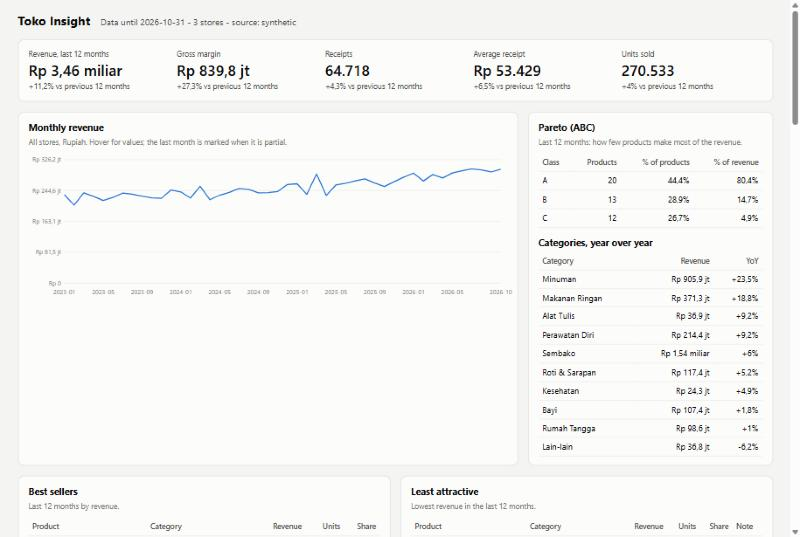
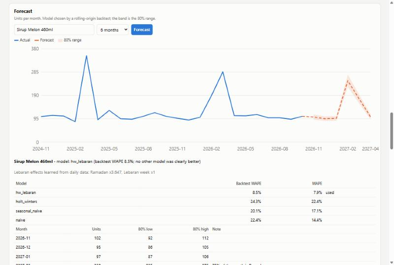
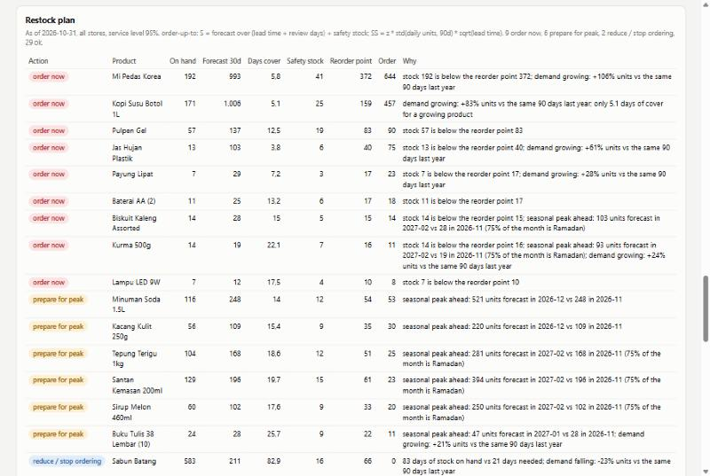
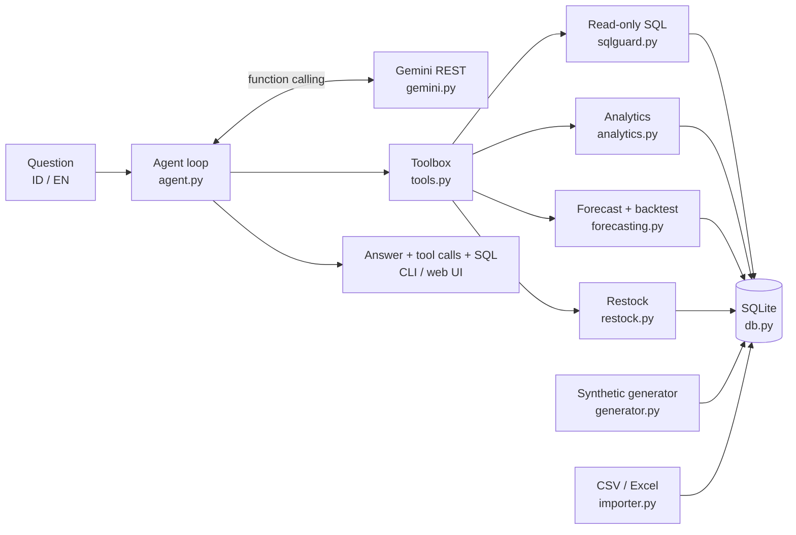

# Toko Insight

An AI analytics agent for a minimarket's sales data. Ask in Bahasa Indonesia or English:
*"Produk apa yang musiman saat Ramadan?"*, *"What is bought together with bread?"*,
*"Which items should I stock more next month, and why?"*. The agent (Gemini with function
calling) answers by calling **safe tools**: read-only SQL and analytics functions. Every
number comes from those tools, never from the model, and each answer lists the tool calls and
SQL that produced it.

> Bahasa Indonesia: [README.id.md](README.id.md)



| Forecast with the Lebaran adjustment | Restock plan with reasons |
|---|---|
|  |  |

Why a separate project from a RAG app: RAG retrieves text. Questions like "which product grew
fastest", "what sells together" or "how much Sirup will we sell in February" need **computation
over tables**: aggregation, statistics and forecasting. This project does that with tool calling,
text-to-SQL and a real, backtested time-series model.

It is inspired by an internship where I built an AWS Bedrock Agent over store sales data. This
version runs on a laptop with only Python's standard library and numpy.

## What it can answer

| Question type | Tool | Method |
|---|---|---|
| Trends over time | `sales_trend` | daily/weekly/monthly/yearly series, peak, low, linear trend |
| Best sellers / least attractive | `top_products`, `abc_analysis` | ranking, Pareto (ABC) classes |
| Growing and declining products | `growth` | year over year, flags new and delisted products |
| Bought often vs rarely | `purchase_frequency` | share of receipts containing the product |
| Bought together | `basket_pairs` | market basket analysis: support, confidence, lift |
| Seasonal products | `seasonality` | event indices for Ramadan (moving Lebaran date), school season, year end, rainy and dry season |
| Forecast | `forecast` | Holt-Winters with a Lebaran adjustment, backtested against seasonal-naive |
| What to stock more or less | `restock_plan` | forecast + safety stock + reorder point vs stock on hand, with reasons |
| Anything else | `run_sql` | one read-only `SELECT`, validated, row- and time-limited |

## Quick start

```powershell
py -m pip install -r requirements.txt -r requirements-dev.txt   # numpy + pytest
py -m tokoinsight generate          # synthetic data: 3 stores, 46 products, Jan 2023 - Oct 2026 (~6 s)
py -m tokoinsight report restock    # works offline, no API key
py -m tokoinsight serve             # dashboard at http://127.0.0.1:8000
py -m pytest                        # 79 tests, fake LLM, no key needed
```

For the chat, copy `.env.example` to `.env` and set `GEMINI_API_KEY` (a free key from
<https://aistudio.google.com/apikey>). `TOKO_MODEL` picks the model (default `gemini-3.8-flash`);
`gemini-3.5-flash-lite` is the fastest and the one used for the evals:

```powershell
py -m tokoinsight ask "Produk apa saja yang musiman saat Ramadan dan menjelang Lebaran?"
py -m tokoinsight chat
```

`ask` prints the answer, then every tool call with its arguments and the SQL it ran.

### Offline reports (no API key)

```powershell
py -m tokoinsight report overview
py -m tokoinsight report top -n 10            # or: bottom, abc, growth, frequency, pairs
py -m tokoinsight report seasonality
py -m tokoinsight report forecast --product "Sirup Melon" --horizon 6
py -m tokoinsight report restock --only-actions
py -m tokoinsight sql "SELECT substr(date,1,4) y, AVG(payment_method='qris') FROM transactions GROUP BY 1"
```

### Your own data

```powershell
py -m tokoinsight --db data/mytoko.db import penjualan.csv
py -m tokoinsight --db data/mytoko.db serve
```

One row per receipt line (or per product per day). Column names are matched in English or
Indonesian (`tanggal/date`, `produk/product`, `jumlah/qty`, `harga/price`, `total/revenue`,
`cabang/store`, `no_nota/receipt`, `hpp/cost`...), and `Rp 12.500` / `12.500,00` and `31/03/2025`
are understood. Excel files need `openpyxl`, or you can save them as CSV. The import reports what
is missing: without a receipt column there is no basket analysis, and without stock levels the
restock plan shows forecasts only.

## Architecture



The agent loop sends the question and the tool declarations to Gemini. Gemini either answers or
asks for function calls. The toolbox runs those calls and sends the results back, and the loop
repeats for up to 8 steps. After that, the model is forced to answer (`toolConfig.mode = NONE`).
Tool errors such as a rejected query or an unknown product go back to the model as data, so it
can correct itself.

## Forecasting: why "hw_lebaran"

Lebaran follows the Hijri calendar and moves about 11 days earlier every year (31 Mar 2025,
20 Mar 2026, 10 Mar 2027). A "same month last year" model therefore puts the Ramadan peak in the
wrong month, and so does plain Holt-Winters with a 12-month season.

`hw_lebaran` handles this in four steps:

1. From daily data, it estimates each product's Ramadan and Lebaran-week effect: units in the
   window divided by the units expected from the 45 days around it, pooled over the years. The
   effect is kept only if it is clearly above noise (|z| > 3), so slow sellers don't get fake
   peaks.
2. It divides each historical month by its holiday factor, `1 + (effect - 1) × share of the
   month's days in the window`.
3. It fits Holt-Winters (damped trend, multiplicative season, parameters by grid search) on the
   adjusted series.
4. It multiplies the forecast by the holiday factor of the **future** months, using the real
   future Lebaran dates.

Every forecast runs a **rolling-origin backtest**: 4 origins × 3 months over the last 12 months,
refitting at each origin. It compares against `seasonal_naive`, plain `holt_winters` and `naive`,
and reports MAPE and WAPE. `hw_lebaran` is used unless another model is clearly better (WAPE
below 85% of it). The 80% range comes from the backtest errors.

## Evaluation

The synthetic generator plants every effect on purpose and stores the ground truth. Planted
effects include Ramadan peaks on the real dates, a grower, a decliner, a delisted product, a new
launch, product pairs, rare products, and over/understocked items. So the expected answers are
known exactly, not judged by another LLM.

Offline results on the default dataset ([evals/reports/offline.md](evals/reports/offline.md)):

- **Analytics: 34/34 checks pass.** These cover the top product by revenue and units, the fastest
  grower, decliners, the delisted and new products, all 14 strongly seasonal products with the
  right season, all 5 planted pairs as the top 5 by lift, rare products, stock-more/stock-less
  decisions, the forecast peaking in the Ramadan month, and the rising QRIS share.
- **Forecast backtest, WAPE over the last 12 months:**

| series | hw_lebaran | holt_winters | seasonal_naive | naive |
|---|---|---|---|---|
| all products (sum of product errors) | **5.5%** | 6.0% | 7.6% | 11.8% |
| Ramadan products | **8.9%** | 18.3% | 17.0% | 19.6% |
| store total | **2.2%** | 2.6% | 4.0% | 7.8% |

On Ramadan products the Lebaran adjustment halves the error. It beats seasonal-naive on 28 of
44 products. For flat, non-seasonal products, the models are close.

**Agent, live on Gemini** (`gemini-3.5-flash-lite`, free tier):

- **Hand-written suite: 13/14.** The 14 questions in [evals/questions.json](evals/questions.json)
  (Indonesian and English) each have expected content (e.g. "Kurma", "Sirup", "Biskuit Kaleng"
  for Ramadan) and expected tools. All 14 picked the right tools. The one miss ran out of steps
  with no text; the agent now asks once more for an answer without tools.
- **Generated suite: 273 of 279 correct (97.8%).** [evalgen.py](tokoinsight/evalgen.py) builds
  500 questions from 15 templates, with exact answers computed by SQL (units, revenue, receipts,
  average basket, QRIS share, top product in a category, pairs, peak season, growth, forecast,
  busiest hour, Lebaran day, promos). The free tier allows 500 requests a day, so the run stopped
  at 279; it resumes where it left off. Indonesian 98.6%, English 97.1%. 97.1% of answers are
  *grounded*: the expected number appears in a tool result, not only in the text. 12 of the 15
  templates scored 100%. Average 2.3 tool calls and 28 s per question.

| template | correct | what went wrong |
|---|---|---|
| QRIS share by store and year | 9/13 | guessed the `payment_method` values in SQL |
| receipts on the first day of Lebaran | 6/7 | counted another date (144 instead of 58) |
| store revenue in a month | 24/25 | reported Rp 3.8 billion instead of Rp 94 million |
| the other 12 templates | 245/245 | |

After the run I added the `payment_method` values to the schema the model sees. That fix has not
been measured yet.

```powershell
py -m tokoinsight eval --suite analytics
py -m tokoinsight eval --suite forecast
py -m tokoinsight eval --suite agent      # needs GEMINI_API_KEY; 14 questions, paced for the free tier
py -m tokoinsight eval --suite agent500   # 500 generated questions; resumable, stops cleanly when the daily quota runs out
```

## Safety

The model can only call the declared tools, and arguments are filtered to declared names, types
and enums. `run_sql` has three layers:

1. A validator: one statement, `SELECT`/`WITH` only, no write/DDL/`PRAGMA`/`ATTACH` keywords or
   dangerous functions outside string literals.
2. A read-only connection: `mode=ro` plus `PRAGMA query_only`.
3. An SQLite **authorizer** that allows only reads, plus a 5-second timeout and a 200-row limit.

The tests show that writes fail even when the validator is bypassed.

## Code tour

| File | What it does |
|---|---|
| `tokoinsight/calendar_id.py` | Lebaran dates 2021-2028, Ramadan / school / year-end windows, upcoming events |
| `tokoinsight/generator.py` | Synthetic minimarket: product specs (base demand, trend, seasons), planted pairs, promos, inflation, QRIS adoption, stock levels, ground truth |
| `tokoinsight/db.py` | SQLite schema, `sales` view, `daily_sales` aggregate, calendar table, query log for showing SQL |
| `tokoinsight/importer.py` | CSV/Excel import with Indonesian/English column aliases and number/date formats; CSV export |
| `tokoinsight/analytics.py` | Trends, top/bottom, ABC, growth, purchase frequency, basket pairs (numpy co-occurrence), seasonality indices |
| `tokoinsight/forecasting.py` | Naive, seasonal-naive, Holt-Winters (numpy), Lebaran adjustment, rolling-origin backtest, model choice |
| `tokoinsight/restock.py` | Safety stock, reorder point, order-up-to level, actions with reasons |
| `tokoinsight/sqlguard.py` | Read-only SQL validator, authorizer, timeout, row limit |
| `tokoinsight/tools.py` | Tool declarations for Gemini, argument cleaning, SQL capture per call, caching |
| `tokoinsight/gemini.py` | Gemini REST client (urllib) with function calling and 429 retry |
| `tokoinsight/agent.py` | System prompt, agent loop, result compaction, answer trace |
| `tokoinsight/evals.py` | Analytics, forecast and agent eval suites |
| `tokoinsight/server.py`, `web/index.html` | Dashboard (KPIs, trend, ABC, seasonal, forecast chart with 80% band, restock plan), chat with tool trace, SQL box |
| `tokoinsight/cli.py` | `generate`, `import`, `report`, `sql`, `ask`, `chat`, `serve`, `eval` |
| `tests/` | 79 pytest tests. `conftest.py` builds one synthetic dataset and a `FakeLLM` that replays Gemini-shaped responses |

## Limitations

- The data is synthetic. It is realistic in shape (Indonesian products, moving Lebaran, rainy
  season, payday, Lebaran-week dip), but it is not a real shop.
- Monthly forecasts need 24 months of history for seasonality. Shorter series fall back to
  damped Holt.
- The restock plan uses a simple periodic-review policy, with a normal approximation for the
  safety stock. It ignores supplier minimums, pack sizes and shelf life.
- The agent's answer quality depends on the LLM. The tools guarantee the numbers, not the
  wording.
